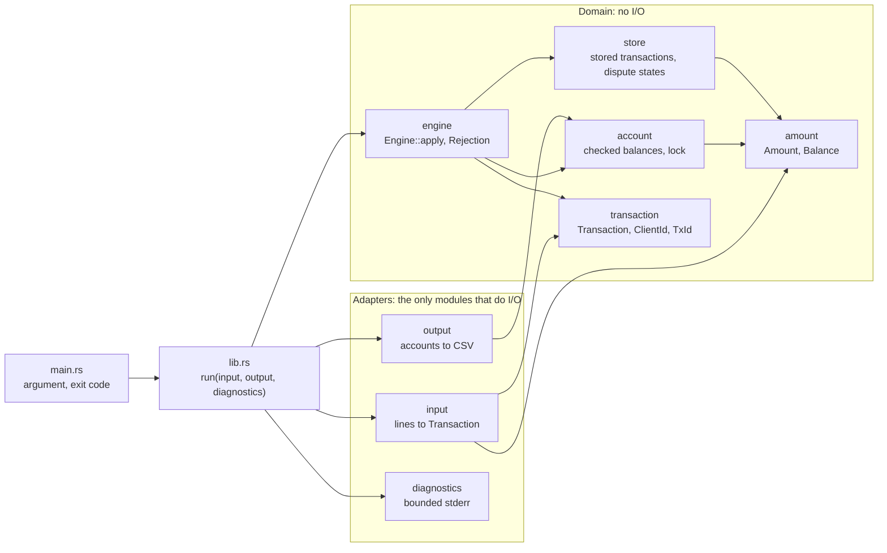
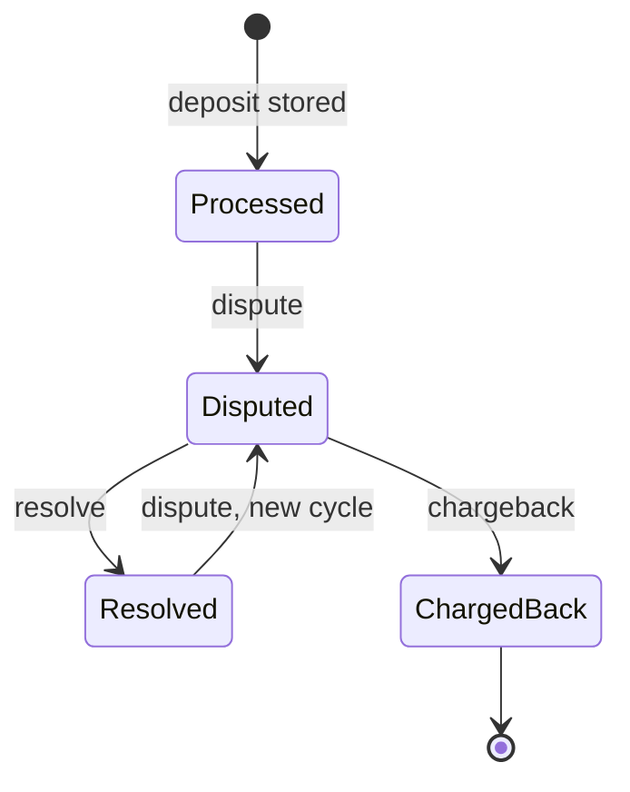

# rust-transactions-practice

A command-line transaction engine. It reads account transactions from a CSV file, applies deposits, withdrawals, disputes, resolves, and chargebacks to client accounts, and writes the final account balances to stdout as CSV.

The behavior contract is [docs/requirements.md](docs/requirements.md). Every decision that goes beyond it is an architecture decision record (ADR) in [docs/decisions/](docs/decisions/). This README summarizes both and links to the detail.

## Usage

```sh
cargo build --release
cargo run -- transactions.csv > accounts.csv
cargo test
```

Use `cargo run --release` for large files. The single argument is always a path, and stdout carries only the account CSV. Rows that are skipped are reported on stderr. The volume is bounded, but writes block, so a caller that pipes stderr must read it or redirect it (for example to a file or `/dev/null`).

Exit codes follow `sysexits.h` ([ADR-0010](docs/decisions/0010-input-validation-and-errors.md) V10):

| Code | Meaning |
|------|---------|
| `0`  | The run completed and stdout holds the full CSV, even if rows were rejected or ignored |
| `64` | Usage error: no argument or more than one |
| `65` | Invalid file data: missing or wrong header, a line over 4 KiB, or a line that ends inside an open quote |
| `66` | The input cannot be opened |
| `74` | I/O error while reading the input or writing stdout |

**Check the exit status before using the output.** Only exit `0` means stdout holds the full CSV. A run that fails before the output phase leaves stdout empty, but a crash, a kill, or a failed write during the output phase can leave a partial file ([ADR-0011](docs/decisions/0011-architecture-and-memory.md), memory model).

Example ([requirements §3](docs/requirements.md#3-output)):

```text
type, client, tx, amount
deposit, 2, 1, 2.0
deposit, 1, 2, 0.5
withdrawal, 3, 3, 1.0
withdrawal, 1, 4, 0.5
dispute, 1, 2,
chargeback, 1, 2,
dispute, 4, 99,
deposit, 2, 5, 0.0001
dispute, 2, 5,
```

gives exactly:

```text
client,available,held,total,locked
1,-0.5000,0.0000,-0.5000,true
2,2.0000,0.0001,2.0001,false
3,0.0000,0.0000,0.0000,false
```

Client 1 withdrew its deposit and then had it disputed and charged back, so the account shows a debt and is locked. Client 3's withdrawal is rejected but still opens a zero-balance account. Client 4's dispute names an unknown transaction and is ignored.

## Design

The crate is a library with a thin binary ([ADR-0011](docs/decisions/0011-architecture-and-memory.md) S1). `main.rs` reads the argument, opens the file, calls `run(input, stdout, stderr)`, and maps the result to an exit code. `run` is generic over `Read` and `Write`, so tests drive the whole pipeline in memory.



Data flow, one row at a time:

1. `input` reads one line into a reused buffer and turns it into a typed `Transaction`, or reports why the row is invalid ([ADR-0015](docs/decisions/0015-hand-written-input-reader.md)). A file-level problem stops the run.
2. `Engine::apply` validates the row against the account and the store, then commits it. It returns `Ok` or a `Rejection` that names the reason, and never half-applies a row (S7).
3. `diagnostics` writes a line for each skipped row, up to 100, and counts every one.
4. After the last row, the summary goes to stderr and the accounts go to stdout, in ascending client order.

Accounts live in a `BTreeMap` keyed by client, which already iterates in output order. Stored transactions live in a `HashMap` keyed by `tx`, with one record for each deposit or withdrawal that was applied or rejected (S8 to S10).

### Dispute state machine

Only deposits enter the lifecycle ([ADR-0006](docs/decisions/0006-dispute-lifecycle.md)). Each move must come from the client that owns the deposit.



| Transition | `available` | `held` | `total` | `locked` |
|------------|-------------|--------|---------|----------|
| dispute | `-amount` (may go negative) | `+amount` | unchanged | unchanged |
| resolve | `+amount` | `-amount` | unchanged | unchanged |
| chargeback | unchanged | `-amount` | `-amount` (may go negative) | `true`, never reverts |

Every other (state, row) pair is ignored. The transitions are one exhaustive `match` with no wildcard arm, so a new state or row type does not compile until each pair is decided (ADR-0011 S11).

## Assumptions

Where the requirements are silent, the engine behaves like a cautious bank. Each line links the decision behind it.

- **Money is exact.** Amounts are integer counts of 0.0001, balances are `i128`, and every operation is checked. Nothing is rounded: `1.00005` is refused, and `1.23450` is accepted as `1.2345`. Signs, exponents, `.5`, and zero are refused. ([ADR-0007](docs/decisions/0007-money-representation.md))
- **Only deposits can be disputed.** A dispute on a withdrawal is ignored, because crediting it back would hand out money on the client's own claim. ([ADR-0006](docs/decisions/0006-dispute-lifecycle.md) R1)
- **Debt stays visible.** A dispute holds the full amount even if it was already withdrawn, so `available` and `total` can go negative. ([ADR-0006](docs/decisions/0006-dispute-lifecycle.md) R2)
- **Only the owner can dispute.** A dispute, resolve, or chargeback from a client that does not own the `tx` is ignored. ([ADR-0006](docs/decisions/0006-dispute-lifecycle.md) R3)
- **A resolved deposit can be disputed again; a chargeback is final.** ([ADR-0006](docs/decisions/0006-dispute-lifecycle.md) R5, R6)
- **A locked account is "post no debits".** Withdrawals are always rejected. Deposits still post, so the client can repay a debt, and disputes still run. Nothing unlocks it. ([ADR-0008](docs/decisions/0008-locked-account-policy.md))
- **Accounts are opened by deposits and withdrawals only,** including a rejected withdrawal. Ignored and invalid rows never add a client to the output. ([ADR-0006](docs/decisions/0006-dispute-lifecycle.md) R8)
- **The first deposit or withdrawal to use a `tx` ID owns it,** even if it was rejected. A later row that reuses the ID is ignored, so it cannot take over or reset a deposit. ([ADR-0010](docs/decisions/0010-input-validation-and-errors.md) V6)
- **A bad row is skipped; a bad file stops the run.** Rows are validated strictly (exact lowercase types, digits-only IDs, strict quoting) and skipped with a reason. A wrong header, an over-long line, or an unterminated quote is fatal, and stdout stays empty. ([ADR-0010](docs/decisions/0010-input-validation-and-errors.md))
- **Output is canonical.** Rows are sorted by client, and every amount has exactly 4 decimals (`2.0000`, `-0.5000`), so each input has exactly one output. ([ADR-0009](docs/decisions/0009-output-format.md))
- **Diagnostics are bounded and safe to read.** Up to 100 detailed lines, then counts per reason. Echoed input is escaped, so a row cannot inject log lines or terminal escapes. ([ADR-0016](docs/decisions/0016-dispute-row-reasons-and-check-order.md), [ADR-0017](docs/decisions/0017-diagnostic-line-format-and-summary.md))

The engine records losses; it cannot prevent them. A client can still withdraw a reversible deposit before the dispute arrives. Stopping that needs settlement information the input does not carry ([requirements §6](docs/requirements.md#engine-boundary), [ADR-0006](docs/decisions/0006-dispute-lifecycle.md#engine-boundary-and-residual-risk)).

## Correctness

Correctness rests on four kinds of evidence ([ADR-0014](docs/decisions/0014-testing-strategy.md)). `cargo test` runs all of them.

- **Unit tests** in each domain module run the rules on typed values, with no files or I/O.
- **Integration tests** (`tests/run.rs`) call `run` on in-memory bytes.
- **Sample cases** (`tests/cases/`) run the real binary. Each case directory has `input.csv` and the expected stdout, stderr, and exit code, written by hand from the rules and compared byte for byte with no normalization. They cover the example above, a locked account with debt, interleaved clients, whitespace and precision, a byte order mark with `\r\n`, malformed rows, the diagnostic cap, and every fatal header and quoting error.
- **Property tests** (`proptest`) generate random row streams with colliding IDs and invalid rows. A test-only wrapper checks the per-row invariants after every row, including money conservation against an independent ledger built from the rows the engine reported as applied. Run-level properties check that the output is deterministic, one row per account, and unchanged when clients' rows are interleaved differently.

The tests are driven by the attack and invariant catalog in [requirements §6](docs/requirements.md#6-threat-model-and-invariants) ([ADR-0013](docs/decisions/0013-attack-and-invariant-catalog.md)). It lists 46 attack scenarios, such as deposit, withdraw, then charge back; a dispute from another client; a negative withdrawal; and a reused `tx` ID. It also lists 18 invariants, such as `total = available + held`, a lock never reverting, `held` always equal to the open disputes, and money being conserved per client and overall. Every row names its test type. A test that covers one row starts with its ID (`a1_…`, `i7_…`), and a test that covers several lists them in a `/// Covers: I1, I2, …` comment, so a search for an ID finds its tests.

Some guarantees hold by construction, and tests still cover them ([ADR-0011](docs/decisions/0011-architecture-and-memory.md), type-system guarantees):

| Guarantee | How |
|-----------|-----|
| A deposit or withdrawal always has a valid, non-zero amount; other rows have none | `Transaction` enum variants, `Amount` wraps `NonZeroU64` |
| Client and transaction IDs cannot be swapped | `ClientId` and `TxId` newtypes |
| `total = available + held` | Private fields, set by one constructor that derives `total` with checked arithmetic ([ADR-0015](docs/decisions/0015-hand-written-input-reader.md) P9) |
| A lock never reverts | No unlock method |
| Only deposits have a dispute state | Only the deposit kind of a stored transaction carries one |
| Every (state, row) pair and every rejection reason is handled | Exhaustive `match` without a wildcard arm |
| The engine can move to another thread | Compile-time `Engine: Send` assertion |

## Safety and robustness

**Errors.** No input can cause a panic. Input is handled through `Result` only, and each failure lands in one class: an invalid or ignored row is skipped with a reason, a valid withdrawal the engine declines is rejected, and a file-level problem is fatal with its exit code. The reasons and the fatal errors are closed enums, so every reason has its own count in the summary and every fatal error has exactly one exit code. A failed write to stderr is ignored and never changes stdout or the exit code. A failed write to stdout exits `74`. ([ADR-0010](docs/decisions/0010-input-validation-and-errors.md))

**Lints and `unsafe`** ([ADR-0012](docs/decisions/0012-dependencies-and-safety-policy.md)). `unsafe` is forbidden. Outside tests, clippy denies `unwrap`, `expect`, `panic!`, indexing and slicing, unchecked arithmetic, `as` casts, floating-point types, and `println!`/`eprintln!`, which panic on a closed pipe. `#[allow]` is denied too. An exception needs `#[expect(lint, reason = "...")]` at the narrowest scope. The only ones today are three `dead_code` expectations on constants that only tests use (`Amount::MIN`, `Amount::MAX`, `Balance::ZERO`), active in non-test builds only. Release builds keep overflow checks on, so any arithmetic bug that slipped past the lints would crash loudly instead of corrupting a balance. Lints cannot see panics inside called functions, so code that handles input uses the non-panicking variants (`get`, `checked_*`), and property tests feed arbitrary bytes to the reader and the amount parser.

**Dependencies.** Each dependency has a recorded reason in ADR-0012 and [ADR-0015](docs/decisions/0015-hand-written-input-reader.md), and `cargo deny check` vets advisories, licenses, and sources against [deny.toml](deny.toml).

| Crate | Used for | Why this one |
|-------|----------|--------------|
| `csv` | Writing the output CSV | The standard CSV crate, widely used and well maintained. It is not used for reading: its parser accepts malformed quoting without an error (`deposit,1,1,"5` reads as `5`), so input goes through our own strict reader ([ADR-0015](docs/decisions/0015-hand-written-input-reader.md)) |
| `serde` (derive) | The output row struct, so the column order lives in one place | The standard serialization framework, which `csv` already depends on |
| `thiserror` | `Display` and `Error` for the error enums | Generates the impls we would write by hand, and adds nothing to the public API |
| `proptest` (dev only) | Property tests | Never linked into the binary. Default features are off to keep its dependency tree small |

## Efficiency

**Streaming.** Input is read one line at a time into one reused buffer, capped at 4 KiB per line, and rows are never collected. Memory grows only with stored state: one 16-byte record for each deposit or withdrawal that was applied or rejected, plus at most 65,536 accounts (a few MiB even if every client appears). Dispute rows, invalid rows, and duplicates add nothing. ([ADR-0011](docs/decisions/0011-architecture-and-memory.md), memory model)

**Per-row cost.** Each row costs constant time on average: one hash lookup or insert, one tree lookup, and a few checked additions. When the transaction table grows, one insert rehashes every stored record. Spread over all inserts, the cost per row stays constant, and only rows that add records can trigger growth. The table uses the standard SipHash hasher with random keys, so crafted `tx` IDs cannot force collisions.

**Measured** on an Apple M5 with 16 GiB, release build ([docs/performance.md](docs/performance.md)):

| Input | Rows | Wall time | Peak memory |
|-------|-----:|----------:|------------:|
| Rows that store nothing | 1M / 10M / 100M | 0.06 s / 0.64 s / 7.2 s | 1.0 MiB at every size |
| Realistic mix of all five types | 1M / 10M / 100M | 0.21 s / 2.4 s / 45–57 s | 58 MiB / 808 MiB / 4.7 GiB |

That is about 4 million rows per second on the mix up to 10 million rows. At 100 million rows it falls to about 2 million per second, because the table filled most of the machine's memory and the system compressed pages. The longest pause is 0.9 s, when the table doubles at about 90 million records. SipHash costs about 10% over an unkeyed fast hash, too little to give up flood resistance. Storing every possible `u32` ID would need about 200 GiB, which no in-memory layout avoids, so the engine is sized for the transactions actually stored; a disk-backed store is the path beyond that.

## Running inside a server

The CLI is single-threaded, because one ordered file gives a second thread nothing to do. The library is ready for a server: it has no global state, and `Engine` is `Send`. [ADR-0011](docs/decisions/0011-architecture-and-memory.md#concurrency-story) describes the design for thousands of concurrent streams. None of it is built.

- **Independent streams** (for example one ledger per partner): one `Engine` per stream, fully parallel, sharing nothing.
- **One shared ledger, stage 1:** connection tasks read, frame, and validate rows in parallel and send them over bounded channels (backpressure) to one engine task that applies every row. This single-writer design is the one used by LMAX and TigerBeetle. Global `tx` uniqueness and the ownership checks work exactly as in the CLI.
- **Stage 2, shards by client:** each shard owns one `Engine` for its clients, and every row goes to the shard of the client it names, so each client's rows stay in order. A registry partitioned by `tx` keeps IDs unique across shards with an atomic insert-if-absent.
- **Routing is not a security boundary.** A dispute naming another client's transaction can land in a shard that also holds the owner, so every shard keeps the ownership check of [ADR-0006](docs/decisions/0006-dispute-lifecycle.md) R3, and its tests still apply.
- **Server-only concerns:** the 4 KiB line cap per connection (an oversized line ends only that connection), capacity reserved from the expected volume to avoid growth pauses, a journal of input events for durability, and diagnostics bounded per connection.

## Documentation

- [docs/requirements.md](docs/requirements.md): behavior contract, including the attack and invariant catalog.
- [docs/performance.md](docs/performance.md): time and memory measured on inputs of up to 100 million rows.
- [CONTRIBUTING.md](CONTRIBUTING.md): setup, local checks, commit, branch, and PR conventions.
- [AGENTS.md](AGENTS.md): instructions for AI coding agents.

### Decision records

| ADR | Decision |
|-----|----------|
| [0000](docs/decisions/0000-use-markdown-architectural-decision-records.md) | Record decisions as Markdown ADRs (MADR) |
| [0001](docs/decisions/0001-keep-exercise-statement-out-of-repository.md) | Confidentiality: what may be committed, and requirements written in this repository's own words |
| [0002](docs/decisions/0002-agents-md-as-single-source-of-agent-instructions.md) | `AGENTS.md` is the single source of agent instructions |
| [0003](docs/decisions/0003-enforce-conventional-commits-with-cocogitto.md) | Conventional Commits, enforced by a cocogitto hook |
| [0004](docs/decisions/0004-branching-squash-merge-and-pr-descriptions.md) | A branch per change, squash merge, Google-style PR descriptions |
| [0005](docs/decisions/0005-toolchain-and-manual-ci.md) | Track stable Rust; CI runs manually, so local checks are the gate |
| [0006](docs/decisions/0006-dispute-lifecycle.md) | Dispute lifecycle: deposits only, full holds, owner checks, terminal chargeback |
| [0007](docs/decisions/0007-money-representation.md) | Money as fixed-point integers with strict parsing and checked arithmetic |
| [0008](docs/decisions/0008-locked-account-policy.md) | A locked account posts no debits and never unlocks |
| [0009](docs/decisions/0009-output-format.md) | Canonical output: sorted rows, 4 fixed decimals, empty stdout on failure |
| [0010](docs/decisions/0010-input-validation-and-errors.md) | Strict validation, skip bad rows, fail closed on file errors, `sysexits.h` codes |
| [0011](docs/decisions/0011-architecture-and-memory.md) | Architecture, memory model, and concurrency story |
| [0012](docs/decisions/0012-dependencies-and-safety-policy.md) | Dependencies, lint policy, and supply-chain checks |
| [0013](docs/decisions/0013-attack-and-invariant-catalog.md) | Attack and invariant catalog: test types, priorities, tests-only checks |
| [0014](docs/decisions/0014-testing-strategy.md) | Test layout, byte-for-byte sample cases, large-input generator |
| [0015](docs/decisions/0015-hand-written-input-reader.md) | A hand-written, strict input reader; `csv` only writes the output |
| [0016](docs/decisions/0016-dispute-row-reasons-and-check-order.md) | Six reasons for ignored dispute rows, ownership checked first |
| [0017](docs/decisions/0017-diagnostic-line-format-and-summary.md) | Diagnostic line format and the end-of-run summary |

## AI assistance

This project was developed with AI coding assistants:

- **Claude Code** (desktop app), mostly with Claude Opus 5.5 and some Claude Sonnet 5.5.
- **OpenAI Codex**.

Work was split into issues: first the design decisions, each recorded as an ADR in [docs/decisions/](docs/decisions/), then implementation, tests, measurement, and review. Each issue ran in its own session and git worktree. The assistants researched options, drafted ADRs, wrote code and tests, and ran the local checks. I chose between options, set the priorities (security, reliability, and stability over leniency), reviewed every change, and merged each pull request.

The full prompts and outputs, unredacted, are shared with reviewers separately instead of being committed here, because they quote the original exercise statement ([ADR-0001](docs/decisions/0001-keep-exercise-statement-out-of-repository.md)).
