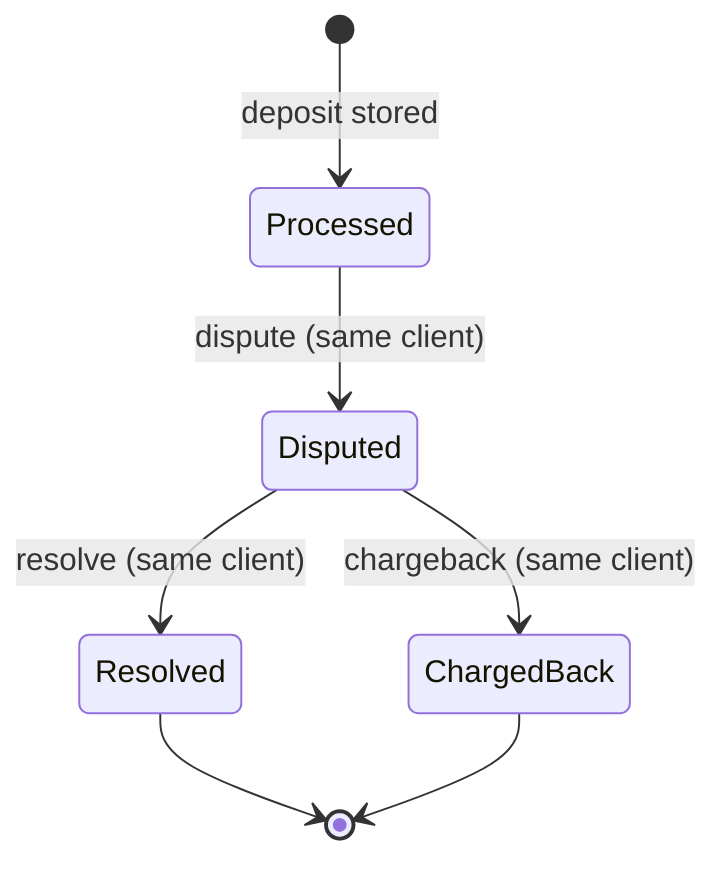

# Define the dispute lifecycle with a platform-protective state machine

## Context and Problem Statement

`dispute`, `resolve`, and `chargeback` carry no amount and refer to an earlier transaction by `tx` ([requirements §5](../requirements.md)). The brief only says to ignore a `resolve` or `chargeback` whose `tx` does not exist or is not under dispute. Everything else is open, and the riskiest case lives here: a user deposits, withdraws the money, and the deposit is then disputed and charged back (scenario A1).

What are the exact states of a disputable transaction, which transitions are legal, and what does each rule do to the balances?

## Decision Drivers

* The platform must be protected from its users. Every rule is chosen to close a gap, not to be lenient.
* The ledger must tell the truth. No rule may hide a loss, and `total = available + held` must always hold.
* Upstream rows can be duplicated, replayed, or wrong. Ignoring them must be safe and noisy, never silent.
* Illegal transitions should be unrepresentable in the type system where practical ([requirements §7](../requirements.md)).
* Every rule must map to a testable scenario in [requirements §6](../requirements.md).

## Considered Options

The choices below were decided one by one. Each lists the options considered and the chosen one.

1. **What can be disputed:** deposits only, or deposits and withdrawals.
2. **Negative `available`:** apply the dispute in full, ignore it when funds are missing, or hold only what is available.
3. **Cross-client references:** ignore, or ignore and also flag the offending client.
4. **Re-dispute after resolve:** final, or re-disputable.
5. **Locked accounts:** allow dispute-related rows and deposits, allow only dispute-related rows, reject every row, or allow everything.

## Decision Outcome

Chosen options, all part of one lifecycle:

### Rules

| # | Rule | One-line bank justification |
|---|------|-----------------------------|
| R1 | Only stored **deposits** are disputable. A dispute, resolve, or chargeback on a withdrawal is ignored. | A dispute claims money should not have entered the account. Crediting a withdrawal back would give the user free funds on their own claim. |
| R2 | A valid dispute always moves the **full** amount from `available` to `held`, even if `available` goes negative. The negative balance is the debt and is printed as is. | The ledger must record the claim against the platform even when the funds were already spent; hiding it lets the attacker keep the money. |
| R3 | A dispute, resolve, or chargeback whose `client` differs from the client that owns the `tx` is **ignored** with a detailed stderr log. | The row must not decide who owns a transaction, or one client could freeze or lock another. |
| R4 | A dispute on a `tx` already in `Disputed` is ignored. | The same deposit must never be held twice, so `held` equals the sum of open disputes. |
| R5 | `Resolved` is **terminal**. A later dispute on that `tx` is ignored. | A resolve closes the claim. The lifecycle only moves forward, so replayed rows cannot toggle funds between frozen and free. |
| R6 | `ChargedBack` is **terminal**. Any later dispute, resolve, or chargeback on that `tx` is ignored. | A chargeback is final. Replaying it must not debit the account twice. |
| R7 | A dispute, resolve, or chargeback on a `tx` that does not exist, was never stored (for example a rejected withdrawal), or is not in the required state is ignored. | Only stored deposits can enter the lifecycle. Everything else is an upstream error. |
| R8 | Only a `deposit` or `withdrawal` row creates a client account, including a rejected withdrawal (balance zero). Ignored rows never create an account. | Garbage rows must not add clients to the output. |
| R9 | A **locked** account still processes `dispute`, `resolve`, and `chargeback` on its stored deposits and **accepts new deposits**, but **rejects every withdrawal**. | The platform must be able to close or enforce every open claim and let the client repay a debt, while no money can ever leave a charged-back account. |

"Ignored" always means: no state change, no balance change, no account created, no failure of the run, and a **loud diagnostic on stderr** that includes the row type, client, `tx`, the owning client (when known), the reason, and the input line number. Silent skips are not allowed.

### State machine

Balance effects, with `a` the deposit amount:

| Transition | `available` | `held` | `total` | `locked` |
|------------|-------------|--------|---------|----------|
| `Processed → Disputed` | `-a` (may go negative) | `+a` | unchanged | unchanged |
| `Disputed → Resolved` | `+a` | `-a` | unchanged | unchanged |
| `Disputed → ChargedBack` | unchanged | `-a` | `-a` (may go negative) | set to `true`, never reverts |

Every other (state, row) pair is ignored under the rules above. Withdrawals are never stored in this state machine.

### Consequences

* Good, because A1 leaves the debt visible: after the chargeback `available = -a` and `total = -a`. Withdrawals stay blocked for good, while deposits can still repay the debt.
* Good, because `held` always equals the sum of the amounts of deposits in `Disputed`, which gives tests a precise invariant.
* Good, because terminal states and the "ignore with a loud log" policy make replayed or duplicated rows harmless and observable.
* Good, because the states can be modeled as separate types whose transition methods consume the previous state, so a chargeback on a `Processed` deposit does not compile.
* Neutral, because negative balances are written to the output unchanged. If a regulator ever requires non-negative displayed balances, the clamp belongs in the output formatting only, as a new ADR that supersedes this one; the ledger must keep the true values for audits. Such a clamp would break `total = available + held` in the printed output.
* Neutral, because flagging a client that sends cross-client rows is not implemented. The detailed log is the hook for adding it later.
* Bad, because `Resolved` being final removes any platform recourse if fraud is discovered after a resolve on that `tx`. Accepted: the input format has no way to express a new claim on the same transaction.
* Bad, because a loud log on every ignored row can produce a lot of stderr output on a hostile input. Accepted: stderr is not part of the output contract.

### Confirmation

* Each rule R1 to R9 is covered by at least one scenario in [requirements §6](../requirements.md) (A1 to A13 and I1 to I5). Unit tests in the implementation issue and sample CSVs under the test data must reproduce those expected outputs.
* A property-style test checks the invariants after every row of a randomized stream: `total = available + held`, `held` equals the sum of open disputes, and `locked` never reverts.
* Review check: no code path may change a balance in response to an ignored row.

### Known limits vs industry practice

Standard controls that the input format cannot express. Each one lists what the engine relies on instead. Adding any of them needs a new ADR.

| Industry control | Why it is out of scope | What protects the platform today |
|------------------|------------------------|----------------------------------|
| **Funds-availability holds**: new deposits cannot be withdrawn for a few days. This is the main defense against A1, because unauthorized ACH returns can arrive up to 60 days later. | Rows carry no timestamps. | R2: the debt stays visible, and negative `available` blocks withdrawals. |
| **Dispute deadlines**: card networks and ACH accept claims only within fixed windows. | Rows carry no timestamps. | None. A dispute can stay open indefinitely, and its funds stay in `held`. |
| **Chargeback reversal**: representment, pre-arbitration, and arbitration can return the money to the merchant. | No row type exists for it. | R6: `ChargedBack` is terminal. |
| **Partial disputes**: a claim can cover only part of the original amount. | Dispute rows carry no amount. | Every dispute covers the full deposit amount. |
| **Dispute-rate monitoring**: networks and ACH rules watch the rate of disputes and unauthorized returns per account or merchant. | Needs per-client counters and thresholds that the output contract does not use. | R3: the detailed stderr log is the hook for flagging clients later. |

## Pros and Cons of the Options

### What can be disputed

* **Deposits only (chosen).** Good, because it matches the spec formulas and closes the provisional-credit abuse. Bad, because disputes against external rails (card networks, banks) are not supported.
* **Deposits and withdrawals.** Bad, because the only coherent version credits money back provisionally, which the user can withdraw again. Neutral, because consumer protection rules such as US Regulation E do let a consumer dispute an unauthorized debit, but that claim is handled by the institution that sent the money, through a provisional credit it can later reverse, not by the platform that received it.

### Negative `available`

* **Apply in full (chosen).** Good, because the ledger stays truthful and the exposure is visible. Bad, because balances can be negative.
* **Ignore when funds are missing.** Bad, because the attacker keeps the money and the ledger hides the loss.
* **Hold only what is available.** Bad, because each dispute must remember its held amount, and a debt remains anyway.

### Cross-client references

* **Ignore with a loud log (chosen).** Good, because no client can affect another's funds.
* **Ignore and flag the client.** Neutral, because it needs extra state that the output contract does not use; kept as a future extension.

### Re-dispute after resolve

* **Final (chosen).** Good, because the lifecycle is monotonic and replay-safe. Bad, because recourse after a resolve is lost.
* **Re-disputable.** Good, because the platform keeps recourse. Bad, because a duplicated `dispute` row silently refreezes funds.

### Locked accounts

* **Dispute-related rows and deposits (chosen).** Good, because open claims can always be closed and the client can repay a negative balance, which is how platforms handle a shortfall after a chargeback or a returned payment. Good, because a deposit on a locked account can only lower the platform's exposure: it can never be withdrawn, and if it is itself charged back the account just returns to the same debt. Neutral, because the lock never reverts even after repayment; the requirements fix that invariant.
* **Dispute-related rows only.** Bad, because a debt like A1 could never be repaid through the engine.
* **Reject every row.** Bad, because other open disputes would keep funds in `held` forever.
* **Allow everything.** Bad, because a charged-back account could keep withdrawing.

## More Information

* Answers the open questions about withdrawal disputes, cross-client references, re-dispute, negative `available`, and locked accounts in [requirements §9](../requirements.md). Duplicate `tx` IDs on deposits and withdrawals, malformed rows, and amount rounding are decided elsewhere.
* Industry references: [Regulation E error resolution, 12 CFR 1005.11](https://www.ecfr.gov/current/title-12/chapter-X/part-1005/subpart-A/section-1005.11) and [Nacha rules on unauthorized return reasons](https://www.nacha.org/rules/differentiating-unauthorized-return-reasons).
* Tracked by issue LYA-41 (D3). The attack catalog (D8) and the dispute implementation (E4) build on the scenarios in requirements §6.
