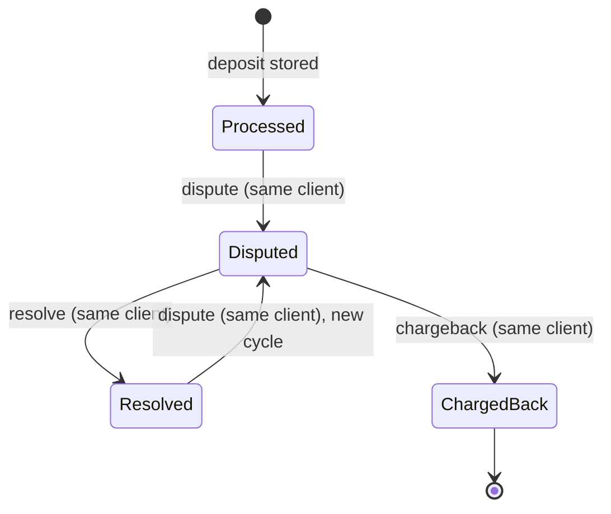

# Define the dispute lifecycle with a platform-protective state machine

## Context and Problem Statement

`dispute`, `resolve`, and `chargeback` carry no amount and refer to an earlier transaction by `tx` ([requirements §5](../requirements.md)). The brief only says to ignore a `resolve` or `chargeback` whose `tx` does not exist or is not under dispute. Everything else is open, and the riskiest case lives here: a user deposits, withdraws the money, and the deposit is then disputed and charged back (scenario A1).

What are the exact states of a disputable transaction, which transitions are legal, what does each rule do to the balances, and where does the engine's protection end?

## Decision Drivers

* The platform must be protected from its users. Every rule is chosen to close a gap, not to be lenient.
* The ledger must tell the truth. No rule may hide a loss, and `total = available + held` must always hold.
* Upstream rows can be wrong. Ignoring them must leave state unchanged and be observable, without letting a hostile input exhaust resources through diagnostics.
* The engine only sees the supplied events. Its documentation must not claim protection it cannot provide.
* Illegal transitions should be unrepresentable in the type system where practical ([requirements §8](../requirements.md)).
* Every rule must map to a testable scenario in [requirements §6](../requirements.md).
* The CLI, CSV schema, output columns, and deposit/withdrawal behavior stay as they are ([requirements §1](../requirements.md)).

## Considered Options

The choices below were decided one by one. Each lists the options considered and the chosen one.

1. **What can be disputed:** deposits only, or deposits and withdrawals.
2. **Negative `available`:** apply the dispute in full, ignore it when funds are missing, or hold only what is available.
3. **Cross-client references:** ignore, or ignore and also flag the offending client.
4. **Re-dispute after resolve:** re-disputable, or final.
5. **Locked accounts:** allow dispute-related rows and deposits, allow only dispute-related rows, reject every row, or allow everything.
6. **Diagnostics volume:** bounded detail with aggregated counts, or a detailed line for every ignored row.

## Decision Outcome

Chosen options, all part of one lifecycle:

### Rules

| # | Rule | One-line bank justification |
|---|------|-----------------------------|
| R1 | Only stored **deposits** are disputable. A dispute, resolve, or chargeback on a withdrawal is ignored. | A dispute claims money should not have entered the account. Crediting a withdrawal back would give the user free funds on their own claim. |
| R2 | A valid dispute always moves the **full** amount from `available` to `held`, even if `available` goes negative. The negative balance is the debt and is printed as is. | The ledger must record the claim against the platform even when the funds were already spent. Recording the debt keeps the loss visible; it does not recover the money (see [Engine boundary](#engine-boundary-and-residual-risk)). |
| R3 | A dispute, resolve, or chargeback whose `client` differs from the client that owns the `tx` is **ignored**. | The row must not decide who owns a transaction, or one client could freeze or lock another. |
| R4 | A dispute on a `tx` already in `Disputed` is ignored. | The same deposit must never be held twice, so `held` equals the sum of open disputes. |
| R5 | A dispute on a `Resolved` deposit **opens a new dispute cycle** (`Resolved → Disputed`) with the same effect as the first dispute. | Payment providers document new disputes against the same payment. Ignoring a real second claim would hide a reversal that already happened outside the engine. |
| R6 | `ChargedBack` is **terminal**. Any later dispute, resolve, or chargeback on that `tx` is ignored. | A chargeback is final under the current input contract. Replaying it must not debit the account twice. |
| R7 | A dispute, resolve, or chargeback on a `tx` that does not exist, was never stored (for example a rejected withdrawal), or is not in the required state is ignored. | Only stored deposits can enter the lifecycle. Everything else is an upstream error. |
| R8 | Only a `deposit` or `withdrawal` row creates a client account, including a rejected withdrawal (balance zero). Ignored rows never create an account. | Garbage rows must not add clients to the output. |
| R9 | A **locked** account still processes `dispute`, `resolve`, and `chargeback` on its stored deposits and **accepts new deposits**, but **rejects every withdrawal**. | The platform must be able to close or enforce every open claim and let the client repay a debt, while no money can ever leave a charged-back account. |
| R10 | Diagnostics for ignored and rejected rows are **bounded**: full detail for the first 100 rows per run, then a single notice that further detail is suppressed, and a summary at the end of the run with one count per reason. Writing to stderr is best effort. | Diagnostics must help investigation without letting a hostile input fill the disk. The cap bounds the volume; it does not make writes nonblocking. |

"Ignored" always means: no state change, no balance change, no account created, no failure of the run, and an entry in the diagnostics under R10. A detailed entry includes the row type, client, `tx`, the owning client (when known), the reason, and the input line number. Every ignored row is counted in the end-of-run summary, so none is skipped silently.

Diagnostics details (R10):

* The limit of 100 detailed entries is one named constant in the code. Each entry has a bounded length; any raw input echoed in it is truncated.
* The summary has one line per reason, so its size is bounded by the number of reasons, not by the input.
* A failure to write to stderr is ignored. It never causes a panic, never changes account state, never touches stdout, and never changes the exit code. In Rust this rules out `eprintln!`, which panics when the write fails.
* The cap bounds diagnostic volume; it does not guarantee nonblocking writes. A write to a full pipe blocks, without returning an error, until the reader consumes data. If the reader stops consuming, the run stalls. Ignoring write errors does not cover this case.
* The caller must drain piped stderr or redirect it to a suitable destination, such as a file or `/dev/null`.
* A stalled stderr destination is an accepted limitation for the current CLI scope. No asynchronous logging or CLI change is introduced for it.
* A failure to write stdout is a real error, handled by the error-handling decision.

### State machine

Balance effects, with `a` the deposit amount:

| Transition | `available` | `held` | `total` | `locked` |
|------------|-------------|--------|---------|----------|
| `Processed → Disputed` | `-a` (may go negative) | `+a` | unchanged | unchanged |
| `Resolved → Disputed` | `-a` (may go negative) | `+a` | unchanged | unchanged |
| `Disputed → Resolved` | `+a` | `-a` | unchanged | unchanged |
| `Disputed → ChargedBack` | unchanged | `-a` | `-a` (may go negative) | set to `true`, never reverts |

Every other (state, row) pair is ignored under the rules above. Withdrawals are never stored in this state machine.

### Event ordering and replays

The CSV cannot tell a replayed `dispute` row from a new dispute cycle against the same transaction, because dispute rows carry no identifier of their own. The engine treats every row as an authoritative event in chronological order ([requirements §2](../requirements.md)).

* **Upstream responsibility:** the system that produces the input must supply authoritative events, in chronological order, with duplicates removed.
* **What the engine still guarantees:** a duplicate dispute while a dispute is open is ignored (R4), and a duplicate chargeback is ignored (R6), so neither can hold or debit twice.
* **What it does not guarantee:** the engine is not replay-safe across dispute cycles. A replayed `dispute` row that arrives after a `resolve` opens a new cycle and freezes the funds again. A later `resolve` releases them.

### Engine boundary and residual risk

The engine applies accounting and withdrawal rules to the events it is given. It cannot tell whether a deposit is irrevocable or safe to withdraw.

**Controls enforced by the engine:**

* Accounting rules and the invariants in [requirements §6](../requirements.md).
* Ownership checks on every dispute, resolve, and chargeback (R3).
* Full-amount holds and visible debt, even when funds were already withdrawn (R2).
* Withdrawals rejected when `available` is insufficient or negative, and permanently after a chargeback (R9).
* Bounded diagnostic volume for ignored rows, with write failures ignored (R10).

**Guarantees required from upstream systems (deployment prerequisites, not established by the CSV):**

* Preventing an uncovered reversal loss requires an upstream system that admits only deposits that are irrevocable, or fully backed by enforceable collateral or a funding guarantee.
* Events are authoritative, chronologically ordered, and deduplicated (see above).
* The caller drains piped stderr or redirects it to a suitable destination (R10).
* Settlement, or a fixed waiting period alone, must not be presented as proof that a payment cannot be reversed. Card disputes can arrive months after the payment, and unauthorized ACH returns up to 60 days later.

**Residual risks accepted for the current scope:**

* Without upstream protection, deposit → withdrawal → dispute → chargeback remains a financial exposure. A client can withdraw a reversible deposit before the dispute arrives. The engine records the resulting debt; it does not prevent the loss or guarantee its recovery.
* A deposit accepted on a locked account (R9) is not a final recovery if that deposit can itself be reversed.
* A stderr reader that stops consuming can block the run, because diagnostic writes are blocking (R10).
* Enforcing withdrawal eligibility inside a production engine (for example, only against irrevocable funds) would need additional input information and a separate ADR. This change does not add settlement events, required flags, or a waiting period.

### Consequences

* Good, because A1 leaves the debt visible: after the chargeback `available = -a` and `total = -a`. Withdrawals stay blocked for good, while deposits can still repay the debt. This records the loss; it does not prevent it.
* Good, because a second dispute after a resolve is recorded (A14), so an external reversal that happens after a resolve still shows up as debt and locks the account on chargeback.
* Good, because `held` always equals the sum of the amounts of deposits in `Disputed`, which gives tests a precise invariant.
* Good, because the states can be modeled as separate types whose transition methods consume the previous state, so a chargeback on a `Processed` deposit does not compile.
* Good, because diagnostic volume stays bounded on hostile input while the summary still counts every ignored row.
* Bad, because a stalled stderr reader can still block the run. Accepted for the current CLI scope; the caller must drain or redirect stderr.
* Neutral, because negative balances are written to the output unchanged. If a regulator ever requires non-negative displayed balances, the clamp belongs in the output formatting only, as a new ADR that supersedes this one; the ledger must keep the true values for audits. Such a clamp would break `total = available + held` in the printed output.
* Neutral, because flagging a client that sends cross-client rows is not implemented. The diagnostics are the hook for adding it later.
* Neutral, because after the first 100 detailed entries, further ignored rows appear only in the summary counts.
* Bad, because a replayed `dispute` row after a `resolve` freezes the funds again. Accepted: a later resolve undoes it, while ignoring a real second claim would be a permanent, silent loss. Deduplication is an upstream responsibility.
* Bad, because the engine cannot prevent the original withdrawal loss in A1. Accepted for the current scope and documented under [Engine boundary](#engine-boundary-and-residual-risk).

### Confirmation

* Each rule R1 to R10 is covered by at least one scenario in [requirements §6](../requirements.md) (A1 to A16 and I1 to I5). These are acceptance criteria for the implementation; they are not executable tests yet. Unit tests and sample CSVs in the implementation issues must reproduce the expected outputs.
* A property-style test checks the invariants after every row of a randomized stream: `total = available + held`, `held` equals the sum of open disputes, and `locked` never reverts.
* Review check: no code path may change a balance in response to an ignored row, and no diagnostic write may panic.

### Known limits vs industry practice

Standard controls that the input format cannot express. Adding any of them needs a new ADR.

| Industry control | Why it is out of scope | Effect on the engine today |
|------------------|------------------------|----------------------------|
| **Funds-availability holds**: new deposits cannot be withdrawn for a period. They reduce exposure but do not prove a payment cannot be reversed. | Rows carry no timestamps or settlement events. | Not prevented. R2 records the debt after the fact; it does not stop the first withdrawal. |
| **Dispute deadlines**: card networks and ACH accept claims only within fixed windows. | Rows carry no timestamps. | None. A dispute can stay open indefinitely, and its funds stay in `held`. |
| **Chargeback reversal**: representment, pre-arbitration, and arbitration can return the money to the merchant. | No row type exists for it. | R6: `ChargedBack` is terminal. |
| **Partial disputes**: a claim can cover only part of the original amount. | Dispute rows carry no amount. | Every dispute covers the full deposit amount. |
| **Dispute-rate monitoring**: networks and ACH rules watch the rate of disputes and unauthorized returns per account or merchant. | Needs per-client counters and thresholds that the output contract does not use. | R10 diagnostics are the hook for flagging clients later. |

## Pros and Cons of the Options

### What can be disputed

* **Deposits only (chosen).** Good, because it matches the spec formulas and closes the provisional-credit abuse. Bad, because disputes against external rails (card networks, banks) are not supported.
* **Deposits and withdrawals.** Bad, because the only coherent version credits money back provisionally, which the user can withdraw again. Neutral, because consumer protection rules such as US Regulation E do let a consumer dispute an unauthorized debit, but that claim is handled by the institution that sent the money, through a provisional credit it can later reverse, not by the platform that received it.

### Negative `available`

* **Apply in full (chosen).** Good, because the ledger stays truthful and the exposure is visible. Bad, because balances can be negative.
* **Ignore when funds are missing.** Bad, because the attacker keeps the money and the ledger hides the loss.
* **Hold only what is available.** Bad, because each dispute must remember its held amount, and a debt remains anyway.

### Cross-client references

* **Ignore with diagnostics (chosen).** Good, because no client can affect another's funds.
* **Ignore and flag the client.** Neutral, because it needs extra state that the output contract does not use; kept as a future extension.

### Re-dispute after resolve

* **Re-disputable (chosen).** Good, because the platform keeps recourse and the ledger records a reversal that happens after a resolve. Bad, because a replayed `dispute` row freezes the funds again; this is reversible by a later resolve.
* **Final.** Good, because the lifecycle only moves forward. Bad, because a real second claim is ignored, leaving an external reversal unrecorded and the account unlocked: a permanent, silent loss.

### Locked accounts

* **Dispute-related rows and deposits (chosen).** Good, because open claims can always be closed and the client can repay a negative balance, which is how platforms handle a shortfall after a chargeback or a returned payment. Good, because a deposit on a locked account cannot increase the platform's exposure: it can never be withdrawn, and if it is itself charged back the account returns to the same debt. Neutral, because such a deposit is not final recovery while it can still be reversed. Neutral, because the lock never reverts even after repayment; the requirements fix that invariant.
* **Dispute-related rows only.** Bad, because a debt like A1 could never be repaid through the engine.
* **Reject every row.** Bad, because other open disputes would keep funds in `held` forever.
* **Allow everything.** Bad, because a charged-back account could keep withdrawing.

### Diagnostics volume

* **Bounded detail with aggregated counts (chosen).** Good, because output size is bounded regardless of input, and every ignored row is still counted. Bad, because rows after the first 100 lose their individual detail. Neutral, because writes stay blocking, so a stalled reader can still block the run.
* **A detailed line for every ignored row.** Bad, because a hostile input can fill the disk through redirected stderr, and the amount a stderr reader must consume grows with the input.

## More Information

* Answers the open questions about withdrawal disputes, cross-client references, re-dispute, negative `available`, and locked accounts in [requirements §10](../requirements.md). Duplicate `tx` IDs on deposits and withdrawals, malformed rows, and amount rounding are decided elsewhere.
* Industry references: [Regulation E error resolution, 12 CFR 1005.11](https://www.ecfr.gov/current/title-12/chapter-X/part-1005/subpart-A/section-1005.11), [Nacha rules on unauthorized return reasons](https://www.nacha.org/rules/differentiating-unauthorized-return-reasons), [Stripe guidance on multiple disputes per payment](https://support.stripe.com/questions/receiving-multiple-disputes-per-payment-faq), the [OWASP Logging Cheat Sheet](https://cheatsheetseries.owasp.org/cheatsheets/Logging_Cheat_Sheet.html) on preventing logging from exhausting resources, and the [Rust `Stdio` documentation](https://doc.rust-lang.org/std/process/struct.Stdio.html) on blocking pipes.
* R9 is detailed, without change, in [ADR-0008](0008-locked-account-policy.md), which lists what a locked account allows for each row type.
* Tracked by issue LYA-41 (D3). The attack catalog (D8) and the dispute implementation (E4) build on the scenarios in requirements §6.
