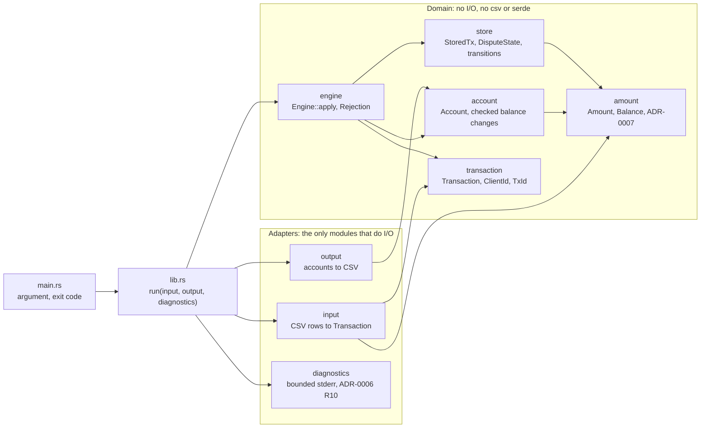
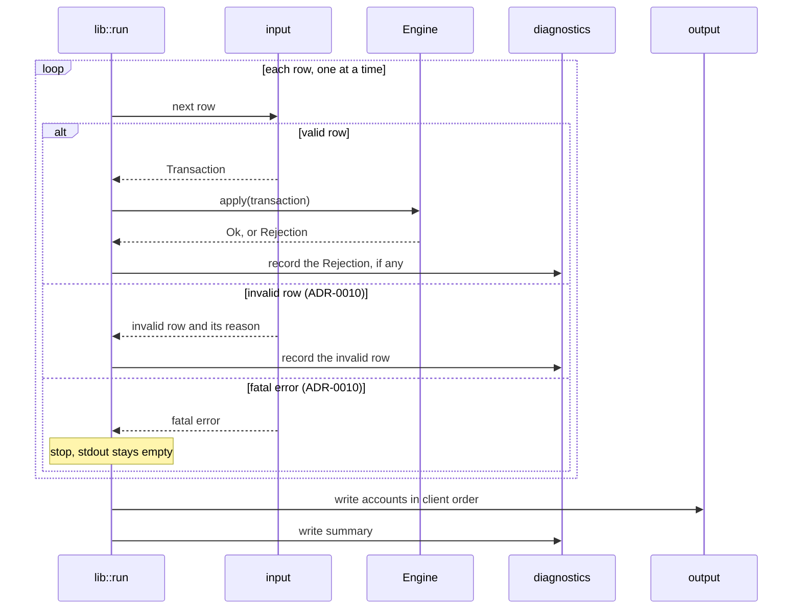
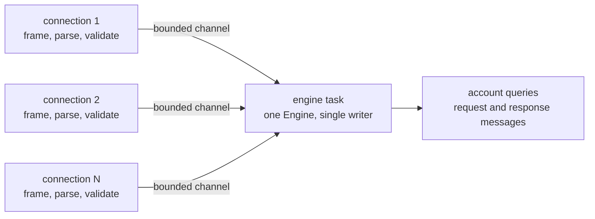
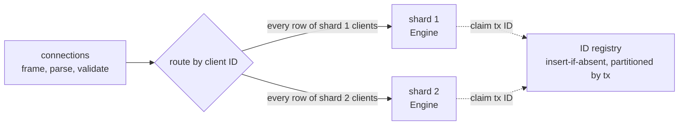

# Structure the engine as an I/O-free core with streaming adapters and indexed in-memory state

## Context and Problem Statement

The engine reads a CSV of chronological events and prints one row per account ([requirements §1 to §5](../requirements.md)). Inputs may be far larger than the samples, transaction IDs span the full `u32` range, and the design must stay compatible with a server that processes many concurrent input streams ([requirements §8](../requirements.md)). Reviewers read the code without the author, so it must also be easy to follow.

How is the crate split into modules, how does input flow through the engine, which data structures hold accounts and stored transactions, how much memory do they cost, and how would the same engine run inside a concurrent server?

## Decision Drivers

* Correct output through the fixed CLI comes first ([requirements §1](../requirements.md)). Nothing in the design may write to stdout except the final CSV.
* Memory must grow with the state the rules require, not with the input. Rows must be streamed.
* Hostile input should not be able to degrade the data structures cheaply (for example by flooding a hash table with colliding keys), and the cost of a row should be constant on average: work that grows with stored state, such as growing a table, must be amortized over many rows.
* Invalid states should be unrepresentable where practical ([requirements §8](../requirements.md)), and every rule of [ADR-0006](0006-dispute-lifecycle.md) and [ADR-0007](0007-money-representation.md) should live in exactly one module.
* The engine must be testable without the CLI, files, or processes.
* The core must move into a thread or an async task unchanged when a server is built.
* Clean, readable code is preferred over clever or micro-optimized code. Optimizations wait for the measurements of E7.
* Every dependency must be justified ([requirements §9](../requirements.md)); fewer is better.
* Decisions are reversible: a later change to one data structure should touch one module.

## Considered Options

The choices below were decided one by one. Each lists the options considered and the chosen one.

1. **Crate layout:** a single binary, or a library plus a thin binary.
2. **Where I/O happens:** inside the engine, or only in adapter modules around an I/O-free core.
3. **Input flow:** load the whole file, deserialize one new record per row, or reuse one line buffer per run.
4. **Field parsing:** serde typed deserialization of each column, or raw fields validated by our own code.
5. **Transaction store:** `HashMap<TxId, _>`, `BTreeMap<TxId, _>`, a dense array indexed by `tx`, or external storage.
6. **What the store records:** deposits only, deposits plus a separate set or bitmap of withdrawal IDs, or one record for every bound ID.
7. **Hash function:** the standard library default (SipHash 1-3 with random keys), the faster unkeyed FxHash, or the faster keyed aHash.
8. **Account store:** `HashMap<ClientId, Account>`, `BTreeMap<ClientId, Account>`, or a fixed array of 65,536 slots.
9. **Concurrency in the CLI:** single-threaded, or a separate reader or parser thread.

## Decision Outcome

Chosen options: a library with a thin binary, an I/O-free core, one reused line buffer, raw fields validated by our own code, a `HashMap` transaction store with the standard hasher that holds one record for every `tx` ID bound under ADR-0010 V6, a `BTreeMap` account store, and a single-threaded CLI. Together they keep memory proportional to stored state, keep each rule in one module, and leave the core ready for a server.

### Rules

| # | Rule | One-line justification |
|---|------|------------------------|
| S1 | The crate is a **library** (`src/lib.rs`) plus a **thin binary** (`src/main.rs`). The binary only reads the argument, opens the file, calls the library's `run` function with the file, locked stdout, and stderr, and maps the result to an `ExitCode` ([ADR-0010](0010-input-validation-and-errors.md) V10, V12). | Tests drive the whole pipeline in memory, and the binary has almost nothing to get wrong. |
| S2 | The **domain modules** (`amount`, `transaction`, `account`, `store`, `engine`) perform no I/O and do not depend on `csv` or serde. Only the **adapter modules** (`input`, `output`, `diagnostics`) read or write. | The rules can be tested exhaustively without files, and the same core can run behind a socket instead of a file. |
| S3 | Input is **streamed**: the `input` adapter reads one line at a time into one reused buffer, and refuses a line longer than `MAX_RECORD_BYTES` before buffering it ([ADR-0010](0010-input-validation-and-errors.md) V9). Input memory is bounded by that constant, never by the file. Rows are never collected. The header is checked once (V8); after that, fields are positional. Quoting follows V14, so a CSV crate, if D7 adopts one, sits behind a strict check. | Input memory is constant, and the reuse avoids one allocation per row, as the `csv` tutorial recommends. |
| S4 | Fields stay **raw byte slices** until one validating constructor in `input` turns a row into a typed `Transaction`, applying ADR-0010 V1 to V5 in column order. No serde or standard-library parser decides the grammar. | Default parsers define their own grammar: Rust's integer parser accepts `+5` as `5`, which V4 forbids. Reading bytes means invalid UTF-8 fails one field, not the run. One function owns what a valid row is, as `Amount` does for amounts (ADR-0007 M3). |
| S5 | `Transaction` is an **enum with one variant per row type**. Only `Deposit` and `Withdrawal` carry an `Amount`. `ClientId` and `TxId` are newtypes. | A dispute with an amount or a deposit without one cannot be constructed, and a client ID cannot be passed where a transaction ID is expected. |
| S6 | The engine API is `Engine::apply(&mut self, Transaction) -> Result<(), Rejection>` plus an iterator over the accounts in ascending client order. `Rejection` is an enum with one variant per diagnostic reason, carrying its context (for example the owning client). The engine never writes diagnostics itself; the `run` loop passes each rejection to `diagnostics`. | The engine stays pure and deterministic, and every reason code of ADR-0010 is counted in the ADR-0006 R10 summary by an exhaustive match. |
| S7 | `apply` **validates, then commits**: it computes every new value (state transition, checked balances) before it changes anything. A rejected withdrawal has exactly the two effects that I3 allows: the zero-balance account of ADR-0006 R8 and the ID binding of ADR-0010 V6. | Invariant I3 then holds by construction: an ignored row cannot leave a half-applied change. |
| S8 | Accounts live in a `BTreeMap<ClientId, Account>`. An `Account` stores `available`, `held`, and `locked`; **`total` is derived** as `available + held` with checked arithmetic. Fields are private and change only through methods that use checked arithmetic. Only the chargeback path calls the lock method, there is no unlock method, and the withdrawal method checks the lock before the funds ([ADR-0008](0008-locked-account-policy.md) L1, L4). | I1 (`total = available + held`) and I2 (`locked` never reverts) hold by construction. The map is bounded by 65,536 clients and iterates in ascending client order, which is the order [ADR-0009](0009-output-format.md) O3 requires, so the output needs no sort. |
| S9 | Stored transactions live in a `HashMap<TxId, StoredTx>` with the **standard library's default hasher**. A `StoredTx` holds the amount, the owning client, and a kind: `Deposit(DisputeState)`, `Withdrawal`, or `RejectedWithdrawal`. It is 16 bytes. | Point lookups by an unsorted ID are what a hash map is for. SipHash with random keys resists hash flooding from crafted IDs. Only deposits have a dispute state, so I5 holds by construction. |
| S10 | The store holds **one record for every `deposit` and `withdrawal` that is applied or rejected**, which is exactly the set of IDs that [ADR-0010](0010-input-validation-and-errors.md) V6 binds. A rejected withdrawal is recorded as `RejectedWithdrawal`: it binds its ID, never enters the dispute lifecycle, and a dispute on it is reported under ADR-0006 R7, as for a transaction that was never stored. Invalid rows, duplicates, and dispute-related rows never add a record. | One lookup answers both questions a row can ask: is this ID already bound (V6), and is it a deposit that can be disputed (R1, R7). One ID holds at most one record, so the worst case stays at 2^32 records. |
| S11 | The dispute transitions of ADR-0006 are **one function with an exhaustive `match` on (state, row type)** and no wildcard arm. | Every pair is decided explicitly and mirrors the ADR-0006 table. Adding a state or row type fails to compile until every new pair is decided. |
| S12 | The `output` adapter is called **once, after the input loop ends**, with the account iterator of S6 and locked stdout. Nothing else in the crate writes to stdout. A run that stops before that point, whether on a fatal error or because memory runs out, leaves stdout empty. | This is how the structure delivers [ADR-0009](0009-output-format.md) O10. The final write is bounded by the number of accounts. |
| S13 | The library has **no global or thread-local state**, and `Engine` is `Send`. The CLI is **single-threaded** and uses no async runtime. | Several engines can run in one process, and an engine can move into a thread or task. One ordered file gives a second thread nothing to do in parallel. |

### Modules

| Module | Owns | Decided by |
|--------|------|------------|
| `amount` | `Amount` (non-zero `u64` units) and `Balance` (`i128` units); strict parsing and exact formatting | ADR-0007 |
| `transaction` | `Transaction` enum, `ClientId`, `TxId` | this ADR (S5) |
| `account` | `Account` and its checked balance changes; derived `total`; the lock | this ADR (S8), ADR-0006 R2 and R9, ADR-0008 |
| `store` | `StoredTx`, `DisputeState`, the transition function | this ADR (S9 to S11), ADR-0006 R1 to R7 |
| `engine` | `Engine`, `Rejection`; applies one row to the account and the store | this ADR (S6, S7) |
| `input` | Line reading, the header check, strict quoting, and the row-to-`Transaction` constructor | this ADR (S3, S4), ADR-0010 |
| `output` | Writing the account rows, including the exact amount format | ADR-0009, this ADR (S12) |
| `diagnostics` | Bounded, escaped stderr reporting and the end-of-run summary | ADR-0006 R10, ADR-0010 V11 |

Module names are the target for E1; a module may be split if it grows, as long as S2 holds.

### Data flow

The `run` function is generic over `Read` for the input and `Write` for the output and the diagnostics, so tests pass byte slices and vectors instead of files and pipes.

### Type-system guarantees

| Guarantee | How | Rule |
|-----------|-----|------|
| A deposit or withdrawal always has a valid amount; other rows never have one | `Transaction` variants (S5) and `Amount` (ADR-0007 M1) | S5 |
| Client and transaction IDs cannot be swapped | `ClientId` and `TxId` newtypes | S5 |
| `total = available + held` (I1) | `total` is derived, not stored | S8 |
| `locked` never reverts (I2) | Private field, no unlock method | S8 |
| Only deposits enter the dispute lifecycle (I5) | Only `StoredKind::Deposit` carries a `DisputeState` | S9 |
| Every (state, row type) pair is handled | Exhaustive `match` without a wildcard arm | S11 |
| Every rejection reason is counted | Exhaustive `match` on `Rejection` in the summary | S6 |
| The engine can move to another thread | Compile-time assertion that `Engine: Send` | S13 |

Not guaranteed by types, and covered by tests instead: that a transition is legal at the time of the row (checked at run time by S11), that `held` equals the sum of the open disputes (I4, property test), and that an ignored row changes nothing (I3, by S7 and tests).

[ADR-0006](0006-dispute-lifecycle.md) notes that the states could be separate types whose methods consume the previous state. A map stores one value type, so the states are one enum and legality is checked by the exhaustive match of S11. The rules R1 to R10 are unchanged.

[ADR-0009](0009-output-format.md) O7 prints the ledger's `total` unchanged. Under S8 that value is derived by the account as `available + held` with checked arithmetic; the output code never computes a balance of its own.

### Memory model

#### Sizes

Measured with `std::mem::size_of` on the pinned toolchain for 64-bit targets.

| Type | Size | Layout |
|------|------|--------|
| `StoredTx` | 16 bytes | amount 8, client 2, kind 1 (the kind and dispute state share one byte), padding 5 |
| `(TxId, StoredTx)` map slot | 24 bytes | key 4, padding 4, value 16 |
| `Account` | 64 bytes | `available` 16, `held` 16, `total` 16, `locked` 1, padding to the 16-byte alignment of `i128`. `total` was added by [ADR-0015](0015-hand-written-input-reader.md) P9; S8 as first written gave 48 bytes |

#### Transaction store

The standard `HashMap` is a SwissTable (the `hashbrown` crate). It stores each slot inline with one control byte, keeps the number of slots a power of two, and grows when it would be more than 7/8 full. Each slot therefore costs 25 bytes, and an entry costs between about 29 and 57 bytes depending on where the count falls between two growth steps. While the table grows, the old and new tables exist together, so the peak is 1.5 times the final table.

| Records (bound `tx` IDs) | Slots | Table | Peak during the last growth | Per entry |
|---------------------------------|-------|-------|-----------------------------|-----------|
| 1 million | 2^21 | 50 MiB | 75 MiB | 52 bytes |
| 10 million | 2^24 | 400 MiB | 600 MiB | 42 bytes |
| 100 million | 2^27 | 3.1 GiB | 4.7 GiB | 34 bytes |
| 1 billion | 2^31 | 50 GiB | 75 GiB | 54 bytes |
| 2^32 (every ID) | 2^33 | 200 GiB | 300 GiB | 50 bytes |

Measured in E7 ([docs/performance.md](../performance.md)): the table sizes match, but on macOS the peak was up to 2 times the final table, not 1.5 times, at 1 million and 10 million records, because the allocator keeps the freed tables of earlier growth steps resident. At about 90 million records the peak was 1.5 times. Plan for up to 2 times the final table.

For comparison, a deposit row is about 15 to 50 bytes of input, so the store costs roughly one to three times the size of the rows that created it. Dispute, resolve, and chargeback rows add nothing, and neither do invalid or duplicate rows.

#### Accounts and buffers

* Accounts: at most 65,536. A `BTreeMap` leaf holds 5 to 11 accounts in 752 bytes (64-byte `Account`). All 65,536 possible accounts measured 6.3 MiB of heap when inserted in random order and 8.0 MiB in ascending order. Typical inputs with few clients take a few KiB.
* Input: one reused line buffer of at most 4 KiB (`MAX_RECORD_BYTES`, ADR-0010 V9), plus a fixed-size read buffer.
* Output: the writer's internal buffer. Rows are formatted one at a time.
* Diagnostics: one counter per reason and at most 100 bounded detailed entries, which are written, not kept.

#### Worst case

Every `u32` ID stored once needs about 200 GiB, with a 300 GiB peak while the table grows, and an input file of at least about 100 GB. No in-memory layout makes this practical: even a dense array with no keys and no padding needs 2^32 × 11 bytes = 44 GiB, and it would cost that for a one-row file too. The engine is therefore sized for the number of transactions actually stored, not for the theoretical range.

If memory runs out while the input is being processed, the allocator aborts the process or the operating system ends it. Under S12 the output has not started at that point, so stdout is empty. The output phase itself allocates almost nothing, but a crash or a kill during it can still leave a partial CSV. Only exit `0` means stdout holds the full CSV ([ADR-0010](0010-input-validation-and-errors.md) V10), so a caller checks the exit status before using stdout. The exit status then comes from the abort or the signal, not from the ADR-0010 V10 table: like a killed process, running out of memory is a failure of the environment, and it is the one way a run can end outside the exit codes of invariant I12.

#### Assumptions

* A 64-bit target, the standard library's `HashMap` and `BTreeMap` of the pinned toolchain, and the layouts above. Allocator overhead is not counted.
* One record per bound `tx` ID (S10). A duplicate never adds a second record (ADR-0010 V6).
* No capacity is reserved up front, because the input size does not tell how many rows are deposits or withdrawals.
* The estimates are checked against measurements in E7. If they differ, this section is updated. E7 confirmed the table sizes and the flat memory on rows that bind no ID, and corrected the growth peak as noted under [Transaction store](#transaction-store); the measurements are in [docs/performance.md](../performance.md).

#### Hostile input

* Crafted `tx` IDs resist hash flooding: the hash keys are random per process (S9), so an attacker cannot compute colliding IDs in advance. Collisions still happen by chance, and the table absorbs them at expected constant cost.
* A long line cannot grow a buffer: a line over `MAX_RECORD_BYTES` is fatal before it is buffered (ADR-0010 V9). A server needs the same cap per connection (see below).
* Per-row work is constant on average, not bounded for every row: one hash lookup or insert at expected constant cost, at most one tree lookup of a few node visits, and a fixed amount of checked arithmetic. An insert that grows the transaction table rehashes every stored record, so a single row can cost work proportional to the stored state. Amortized over all inserts, the cost per row stays constant, which is how the Rust collections documentation states the cost of `HashMap::insert`. Input can trigger growth only by adding records, so the total growth work stays proportional to the number of records.

### Concurrency story

The CLI processes one ordered file, so it stays single-threaded (S13). This section describes how the same core would run inside a server that accepts many concurrent input streams, such as TCP connections. It is documentation only; nothing here is built now.

#### What stays the same

The domain modules do not change. Each connection gets its own `input`-style parser over a socket instead of a file, and each `Engine` runs inside one thread or task that owns it. No engine is shared behind a lock.

#### Independent streams

If each stream is its own ledger (for example one stream per partner, with separate clients and IDs), each stream gets its own `Engine`. Streams share nothing, so they run fully in parallel.

#### One shared ledger, stage 1: single writer

* Connection tasks do the parallel work: reading, framing, parsing, and validating rows into `Transaction` values.
* One engine task applies every transaction. This is the design of the LMAX exchange and of TigerBeetle, which keep the ledger logic on one thread and parallelize the I/O around it.
* Global `tx` uniqueness and cross-client checks work exactly as in the CLI, because one engine sees every row.
* Channels are bounded, so a fast connection is slowed down (backpressure) instead of growing a queue without limit.
* Account queries are messages to the engine task, not shared reads, so a reader never sees a half-applied row.

#### One shared ledger, stage 2: shards by client

When one core is no longer enough, the clients are split into N shards. Each shard owns one `Engine` with its clients' accounts and the transactions those clients own.

* **Routing:** every row, of any type, goes to the shard of the client named in the row. A connection sends to each shard through one FIFO channel, so the rows of one client keep their order. No row type takes a separate path: a deposit that passed through an extra stage could be overtaken by its own dispute, which would then be ignored as unknown.
* **Ordering contract:** the chronological order of [requirements §2](../requirements.md) becomes a per-client order. The rows of one client must arrive on one connection, or carry a per-client sequence number that the shard checks. Rows of different clients have no defined order between connections, and no rule depends on one.
* **Cross-client references (R3):** a transaction lives in the shard of the client that owns it, and each shard holds many clients. A dispute naming another client goes to that client's shard. If the owner is in a different shard, the `tx` is unknown there, so the row is ignored without touching the owner's state. Its diagnostic then reports an unknown transaction and cannot name the owner, which ADR-0006 already allows (the owning client is named "when known"). If both clients share the shard, the engine finds the transaction, and its unchanged ownership check (ADR-0006 R3) ignores the row. Routing is therefore not a security boundary: every shard keeps the R3 check, and its tests (A4, A5) still apply.
* **Global `tx` uniqueness:** shards cannot see each other's IDs. Once a shard has validated a deposit or withdrawal and knows it would be applied or rejected, it claims the ID in a registry partitioned by `tx` (an atomic insert-if-absent) before it commits, as part of S7's validate-then-commit step. A failed claim makes the row an ADR-0010 V6 duplicate, which is ignored. Rows the shard ignores never claim, so no claim is ever released, and invalid rows never reach a shard. If two shards claim the same ID at the same time, one wins; rows of different clients have no defined order, so either result is valid. The claim adds a round trip to every deposit and withdrawal. An alternative is an upstream guarantee that ID ranges never overlap between clients, which removes the registry.
* **Hot clients:** one very active client is limited to the throughput of its shard. TigerBeetle names hot accounts as the main reason it does not shard; stage 1 should be measured before stage 2 is built.

#### Server-only concerns

* **Framing limit:** each connection keeps the ADR-0010 V9 line cap (for example with `tokio_util::codec::LinesCodec::new_with_max_length`), because many connections share one process. Unlike in the CLI, an oversized line should end that connection only, not the whole server.
* **Growth pauses:** in a single-writer engine, the row that grows a large table stalls every connection until the rehash ends. A server reserves capacity from the expected volume, or splits the store into several smaller tables so that each growth step is small.
* **Durability:** the in-memory state is lost on a crash. A server journals each accepted input event before applying it and rebuilds state by replaying the journal, with periodic snapshots, as LMAX does.
* **External storage:** the worst case above does not fit in memory. A server that must hold every ID moves the transaction store to an embedded key-value store on disk. Only the `store` module changes.
* **Diagnostics:** the per-run bound of ADR-0006 R10 becomes a per-connection or per-period bound with structured logs.

### Consequences

* Good, because every rule lives in one domain module, and the domain modules can be tested without files, pipes, or processes.
* Good, because memory grows only with bound `tx` IDs and accounts. A file of a billion disputes on unknown IDs costs no more memory than an empty file.
* Good, because I1, I2, and I5 hold by construction, and I3 holds by the validate-then-commit structure of `apply`.
* Good, because the account store already iterates in the order ADR-0009 O3 requires, so byte-identical output (I10) needs no sort step.
* Good, because a run that stops before the output phase, on a fatal error or when memory runs out, leaves stdout empty. A crash or a failed write during the output phase can still leave a partial CSV, so only exit `0` means the CSV is complete (ADR-0010 V10).
* Good, because the domain modules need no dependency, and the input adapter needs no serde derive: the header and fields are checked by our own code under ADR-0010. D7 decides whether a CSV crate sits behind the strict check.
* Good, because the server story reuses the core unchanged: stage 1 needs only channels around one `Engine`, and stage 2 adds routing and an ID registry outside it.
* Bad, because the full `u32` worst case needs about 200 GiB and cannot run on common hardware. Accepted: no in-memory layout fits it, and external storage is future work behind the `store` module.
* Bad, because the standard hasher is slower than FxHash or aHash. Accepted for resistance to crafted IDs; E7 measures the cost, and the hasher is one type parameter.
* Bad, because a `StoredTx` wastes 5 bytes of padding, and a withdrawal record keeps an amount no rule needs. Packing the layout or moving withdrawals to a smaller set would save memory at the cost of clarity. Both stay options for E7.
* Neutral, because ADR-0010 V6 makes typical memory grow with every bound ID, including rejected withdrawals, not only with deposits. The worst case is unchanged (S10).
* Neutral, because the account map uses a tree instead of a hash table. At 65,536 entries at most, the lookup is a few node visits, and ordered iteration comes for free.

### Confirmation

* Unit tests for `engine`, `account`, and `store` run on typed `Transaction` values without any CSV.
* Integration tests call `lib::run` with byte slices and vectors, covering the full pipeline without a process.
* A compile-time assertion checks that `Engine` is `Send`.
* A test with a large generated input checks that memory stays flat when the rows add no stored state (disputes on unknown IDs), and E7 compares the table above with measured peak memory and records the slowest single row on a large input, which shows the cost of table growth.
* Review checks: no module in the domain group imports `csv`, serde, `std::io`, or `std::fs`; no `static mut`, `thread_local!`, or other global state; no wildcard arm in the transition match or in the summary match; nothing is written to stdout before all input is applied.

## Pros and Cons of the Options

### Crate layout

* **Library plus thin binary (chosen).** Good, because tests drive the engine directly and the binary stays trivial. Neutral, because it adds one file.
* **Single binary.** Bad, because tests must spawn the process to reach the engine, or the engine must be tested through `main.rs` internals.

### Where I/O happens

* **Adapters around an I/O-free core (chosen).** Good, because the rules are deterministic and easy to test, and the core moves to a server unchanged. This is the usual "functional core, imperative shell" or ports-and-adapters split.
* **I/O inside the engine.** Bad, because every rule test needs a writer, and the engine would carry the CLI's decisions about stderr into a server.

### Input flow

* **One reused line buffer (chosen).** Good, because memory per row is constant and there is no allocation per row. Neutral, because the loop is a few lines longer than an iterator.
* **A new deserialized record per row.** Good, because it is the shortest code. Bad, because it allocates for every row, which the `csv` tutorial shows is a measurable cost.
* **Load the whole file.** Bad, because memory grows with the file, which [requirements §8](../requirements.md) rules out.

### Field parsing

* **Raw byte fields and our own validation (chosen).** Good, because one function defines the row grammar of ADR-0010, as ADR-0007 does for amounts, and no serde derive is needed. Bad, because the header positions and conversions are written by hand.
* **Serde typed deserialization.** Good, because it is idiomatic and short. Bad, because the column grammar becomes whatever the default parsers accept, such as `+5` for an integer, and the derive adds build-time code to the dependency tree.

### Transaction store

* **`HashMap` (chosen).** Good, because lookups take expected constant time, inserts take amortized expected constant time, and the memory per entry is close to the raw record size. Bad, because each growth step rehashes every record at once and temporarily needs 1.5 times the table.
* **`BTreeMap`.** Good, because it needs no hash function and grows without a resize peak. Bad, because every lookup visits several nodes, often a cache miss each for unsorted IDs, and the memory per entry is similar.
* **Dense array indexed by `tx`.** Good, because lookup is one index. Bad, because it costs 44 to 64 GiB for any input, including a one-row file.
* **External storage (embedded key-value store on disk).** Good, because the worst case fits. Bad, because it adds a large dependency and disk I/O for a CLI whose realistic inputs fit in memory. Kept as future work behind the `store` module.

### What the store records

* **One record for every bound ID (chosen).** Good, because one lookup checks ADR-0010 V6 and dispute eligibility, and the kind tells R1 from R7 for the diagnostic. Bad, because a withdrawal takes a full 16-byte record although no rule reads its amount.
* **Deposits in the map, withdrawal IDs in a separate set.** Good, because a withdrawal ID would cost about 9 bytes per slot instead of 25. Bad, because every deposit and withdrawal needs two lookups to check V6, and the two structures must stay consistent. Kept as an option for E7.
* **Deposits plus a fixed bitmap of every `u32` ID.** Good, because one bit per ID is the smallest exact set for dense IDs. Bad, because it costs 512 MiB on every run, including a one-row file.
* **Deposits only.** Bad, because V6 could not be enforced: a later row could reuse a withdrawal's ID.

### Hash function

* **Standard library default (chosen).** Good, because SipHash with random keys is the standard library's defense against hash flooding, and the IDs come from untrusted input. Good, because it needs no dependency. Bad, because it is slower than FxHash and aHash.
* **FxHash.** Good, because it is among the fastest hashes for integer keys. Bad, because it is unkeyed: anyone can compute colliding IDs in advance and flood the table. Bad, because it adds a dependency.
* **aHash.** Good, because it is faster than SipHash and keyed with random keys taken from the operating system, so it is designed to resist the same flooding. Bad, because it adds a dependency, and it is a non-cryptographic hash, while SipHash is a keyed pseudorandom function with more public analysis. It is the first candidate if E7 shows that the standard hasher is too slow.

### Account store

* **`BTreeMap` (chosen).** Good, because memory follows the number of clients, iteration is in client order, and no hash function is involved. Neutral, because a lookup visits a few nodes.
* **`HashMap`.** Good, because lookups take expected constant time. Bad, because its iteration order changes between runs, so the accounts must be sorted before printing to meet ADR-0009 O3.
* **Fixed array of 65,536 slots.** Good, because a lookup is one index. Bad, because every run, and every shard in a server, pays about 3 MiB up front, and the output must skip empty slots.

### Concurrency in the CLI

* **Single-threaded (chosen).** Good, because the file is ordered and parsing is cheap, so the run is bound by reading the file. The code has no synchronization at all.
* **Separate reader or parser thread.** Good, because parsing could overlap with applying. Bad, because it adds channels and shutdown handling for a gain that E7 has not shown.

## More Information

* Invariants not guaranteed by types are checked by tests only, never at run time, and the per-client ordering contract of stage 2 is stated as invariant I18; see [ADR-0013](0013-attack-and-invariant-catalog.md).
* Industry references:
  * The [`csv` tutorial](https://docs.rs/csv/latest/csv/tutorial/index.html) on internal buffering ("Reading CSV"), reusing one record ("Amortizing allocations"), and borrowed fields ("Serde and zero allocation").
  * The [Rust `HashMap` documentation](https://doc.rust-lang.org/std/collections/struct.HashMap.html) on the default SipHash 1-3 hasher and its resistance to HashDoS attacks, the [Rust collections performance table](https://doc.rust-lang.org/std/collections/index.html#performance), which lists `HashMap::insert` as expected and amortized constant time, and the [SwissTable design notes](https://abseil.io/about/design/swisstables) behind its layout.
  * The [aHash documentation](https://docs.rs/ahash/latest/ahash/), which describes it as a keyed hash with keys from the operating system.
  * Martin Fowler's description of the [LMAX architecture](https://martinfowler.com/articles/lmax.html): a single-threaded business logic processor with parallel input and output stages and event-sourced recovery.
  * TigerBeetle's [performance notes](https://docs.tigerbeetle.com/concepts/performance/): single-threaded by design, because hot accounts make sharding a financial database hard.
  * The [`LinesCodec` documentation](https://docs.rs/tokio-util/latest/tokio_util/codec/struct.LinesCodec.html), which recommends a maximum line length for any codec exposed to untrusted input.
* Related decisions: duplicate `tx` IDs, malformed rows, the record size limit, quoting, the classification of invalid rows, and exit codes are decided by [ADR-0010](0010-input-validation-and-errors.md) (D5). The output layout and the "nothing on stdout after a failure" rule come from [ADR-0009](0009-output-format.md) (D2), and the locked-account behavior from [ADR-0008](0008-locked-account-policy.md) (D4). The dependency list and lint policy are decided by D7 (LYA-45); this ADR only requires that the domain modules have no dependency.
* The large-input generator used for these measurements is decided in [ADR-0014](0014-testing-strategy.md) T12. The E7 measurements, including the slowest growth step and the cost of the standard hasher (about 10% of the run time, so S9 stands), are in [docs/performance.md](../performance.md).
* [ADR-0015](0015-hand-written-input-reader.md) P9 refines S8: an `Account` also keeps `total`, set only by the constructor that checks it, so the account is 64 bytes instead of 48.
* Revisit this decision if E7 shows that memory or speed is far from the estimates, if inputs must hold more transactions than fit in memory, or when a server is built.
* Tracked by issue LYA-44 (D6). The crate skeleton (E1), the efficiency measurements (E7), and the README design section (E8) build on this ADR.
